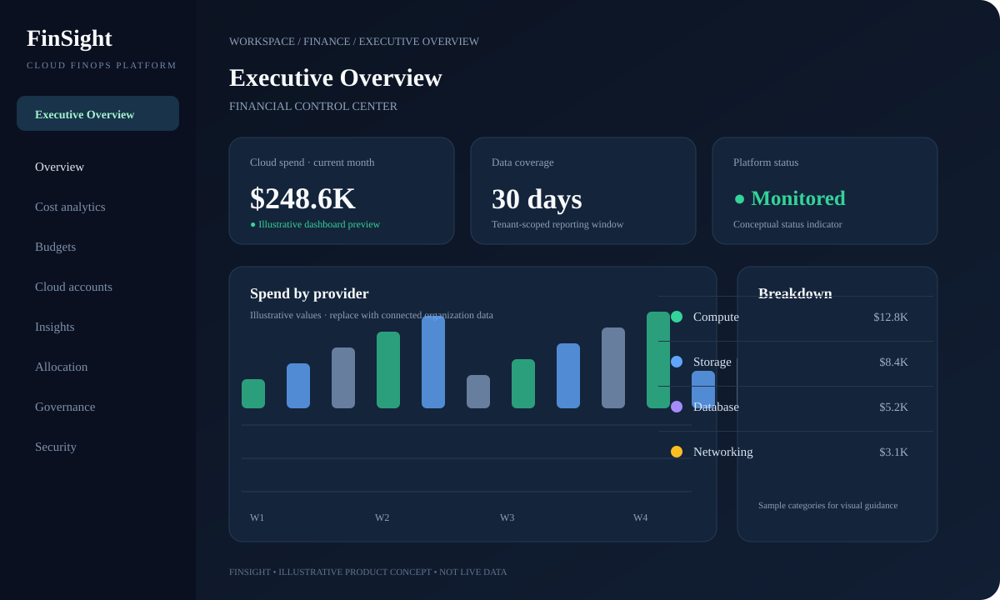
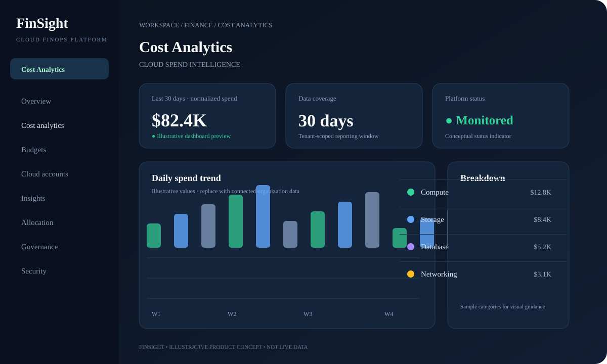
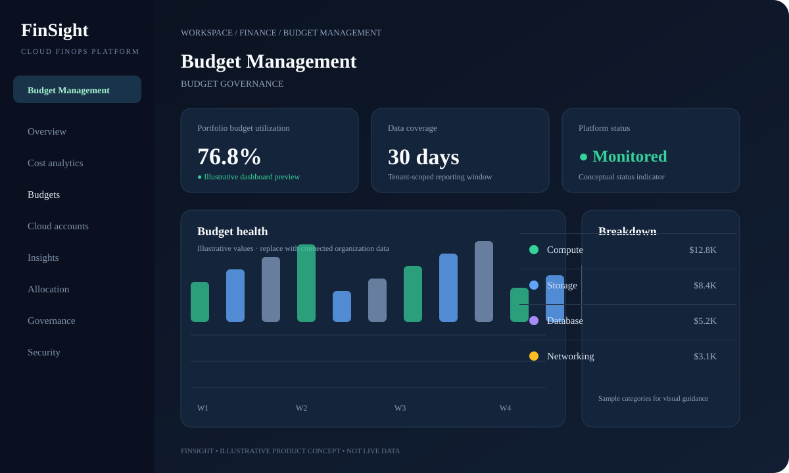
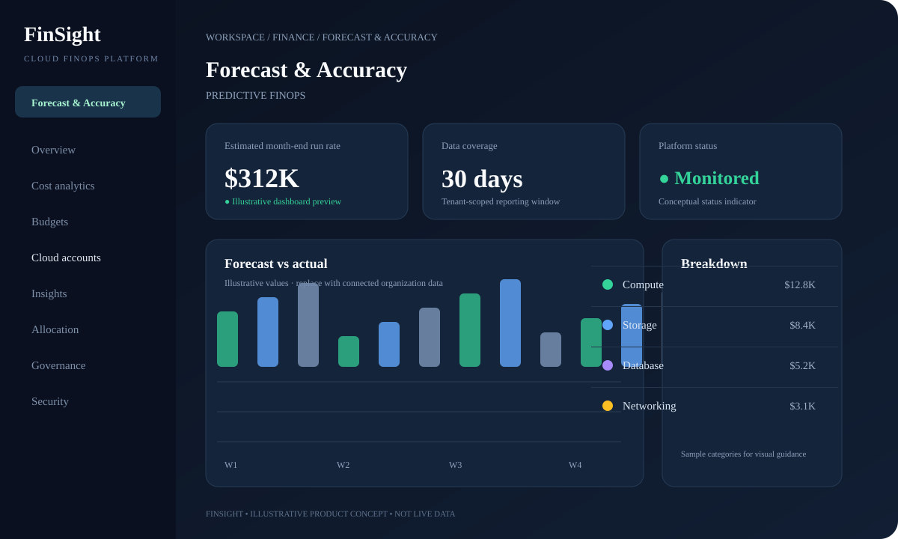
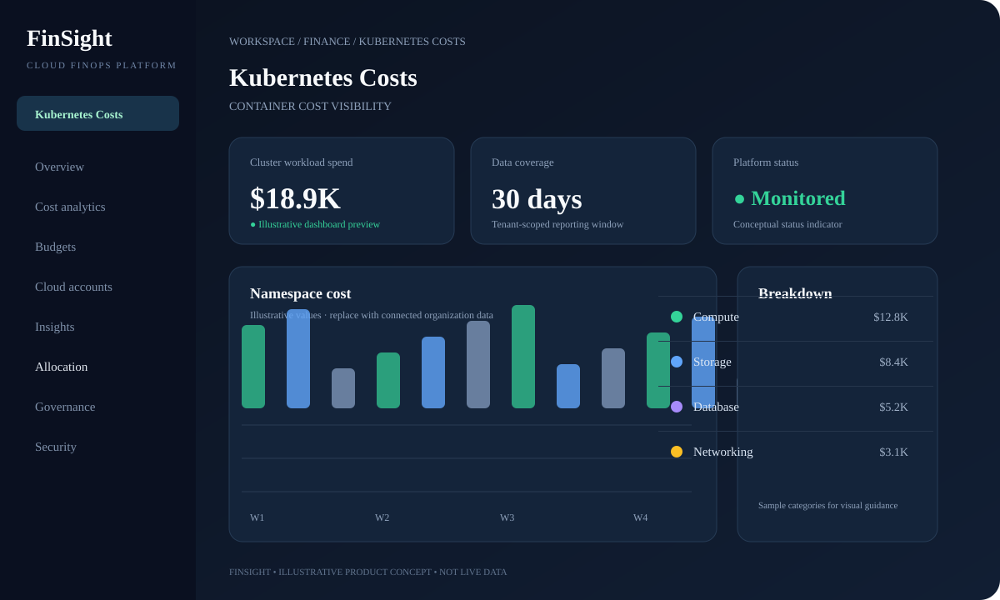
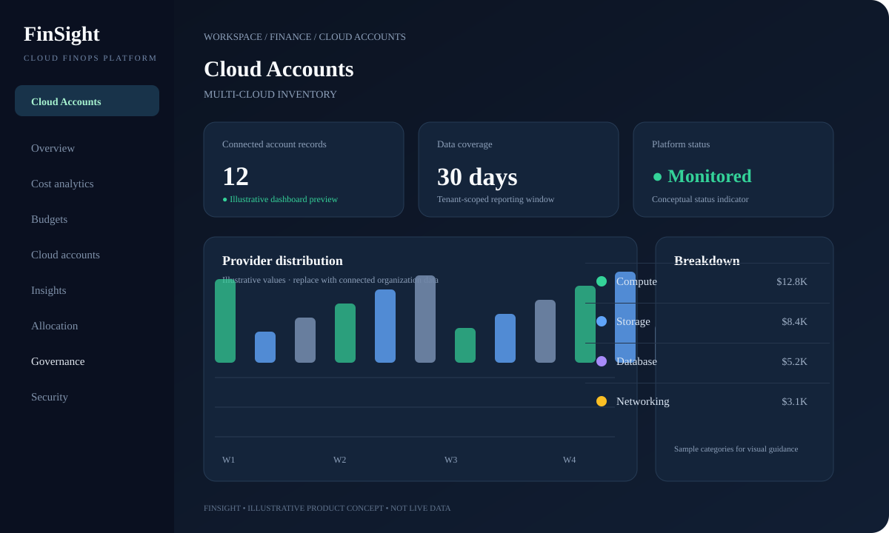
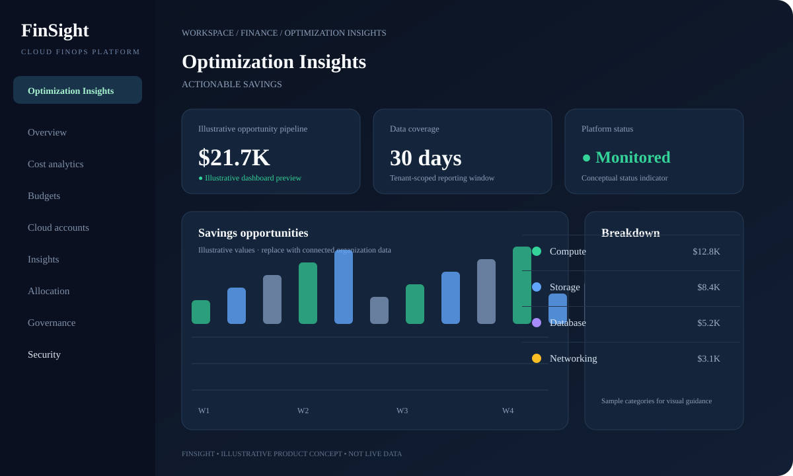
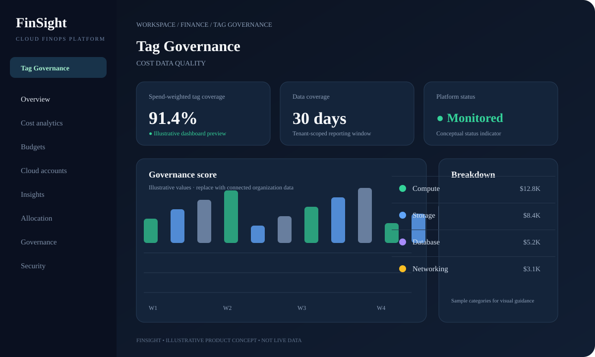
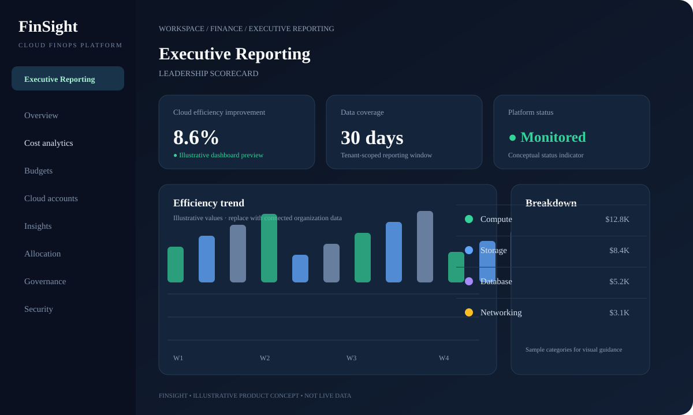
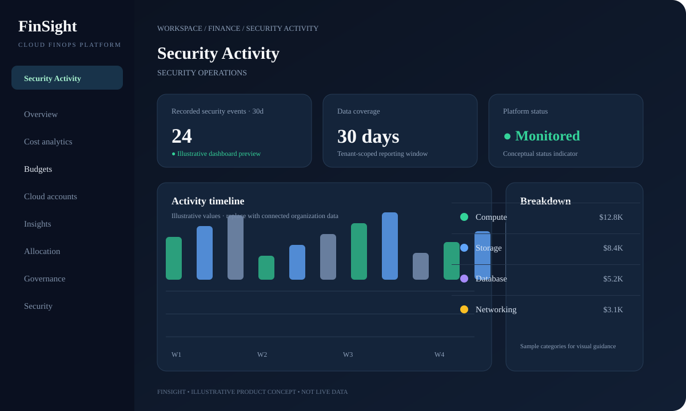

<div align="center">

# FinSight

### Enterprise Cloud FinOps & Cost Intelligence Platform

**Understand cloud spend. Govern budgets. Allocate ownership. Improve efficiency.**

A multi-tenant FinOps workspace for engineering, finance, and platform teams — bringing cloud cost analytics, budgeting, showback, optimization signals, governance, and security operations into one product.

[Repository](https://github.com/matiur25580/enterprise-cloud-finsight-platform) · [Issues](https://github.com/matiur25580/enterprise-cloud-finsight-platform/issues) · [Pull requests](https://github.com/matiur25580/enterprise-cloud-finsight-platform/pulls)

</div>

---

## Project at a glance

| | |
|---|---|
| **Application** | Next.js App Router · React · TypeScript |
| **Data platform** | PostgreSQL · Prisma · Row-Level Security |
| **Identity & access** | Auth.js · bcrypt · organization RBAC |
| **Cloud coverage** | AWS · Microsoft Azure · Google Cloud |
| **Core workflows** | Cost analytics · budgets · forecasts · allocation · governance · security |
| **Engineering quality** | ESLint · TypeScript · automated tests · GitHub Actions · CodeQL |

> **Development status:** Active development. Core product workflows and the security foundation are implemented. Production provider credentials, external secret-backend configuration, email verification, MFA, and final deployment hardening require environment-specific setup and verification. This README distinguishes implemented application capabilities from operator configuration and future work.

## Dashboard gallery

The following 12 visuals are **illustrative dashboard concepts**, created to explain the product areas and intended information architecture. They are not screenshots of a running deployment and contain sample values, not customer or production data. Actual workspace views use organization-scoped records and explicit empty states.

<table>
<tr><td width="50%"><a href="docs/dashboard-previews/01-executive-overview.svg"></a><br/><strong>01. Executive overview</strong><br/><sub>Leadership snapshot of cloud spend, reporting coverage, and operational status.</sub></td><td width="50%"><a href="docs/dashboard-previews/02-cost-analytics.svg"></a><br/><strong>02. Cost analytics</strong><br/><sub>Spend trends and service-level cost analysis across the selected reporting window.</sub></td></tr>
<tr><td width="50%"><a href="docs/dashboard-previews/03-budget-management.svg"></a><br/><strong>03. Budget management</strong><br/><sub>Budget utilization and portfolio-level financial guardrails.</sub></td><td width="50%"><a href="docs/dashboard-previews/04-forecast-accuracy.svg"></a><br/><strong>04. Forecast & accuracy</strong><br/><sub>Month-end run-rate forecasting and forecast-versus-actual review.</sub></td></tr>
<tr><td width="50%"><a href="docs/dashboard-previews/05-cost-allocation.svg"></a><br/><strong>05. Cost allocation</strong><br/><sub>Team and business ownership views for cloud showback.</sub></td><td width="50%"><a href="docs/dashboard-previews/06-kubernetes-costs.svg"></a><br/><strong>06. Kubernetes costs</strong><br/><sub>Container and namespace cost visibility for platform teams.</sub></td></tr>
<tr><td width="50%"><a href="docs/dashboard-previews/07-cloud-accounts.svg"></a><br/><strong>07. Cloud accounts</strong><br/><sub>AWS, Azure, and Google Cloud account inventory and status.</sub></td><td width="50%"><a href="docs/dashboard-previews/08-optimization-insights.svg"></a><br/><strong>08. Optimization insights</strong><br/><sub>Ranked opportunities with transparent illustrative savings assumptions.</sub></td></tr>
<tr><td width="50%"><a href="docs/dashboard-previews/09-tag-governance.svg"></a><br/><strong>09. Tag governance</strong><br/><sub>Tag coverage and unallocated-spend governance signals.</sub></td><td width="50%"><a href="docs/dashboard-previews/10-executive-reporting.svg"></a><br/><strong>10. Executive reporting</strong><br/><sub>Leadership reporting for cloud efficiency and financial performance.</sub></td></tr>
<tr><td width="50%"><a href="docs/dashboard-previews/11-security-activity.svg"></a><br/><strong>11. Security activity</strong><br/><sub>Tenant-scoped security events and abuse-signal monitoring.</sub></td><td width="50%"><a href="docs/dashboard-previews/12-incident-response.svg"></a><br/><strong>12. Incident response</strong><br/><sub>Owner/Admin incident triage and lifecycle management.</sub></td></tr>
</table>

## What FinSight helps teams do

1. **See cloud spend clearly** — analyze daily and monthly trends, compare periods, and break down costs by provider, account, and service.
2. **Control budgets** — monitor utilization, threshold signals, forecasts, alert history, and forecast accuracy.
3. **Allocate ownership** — support team, project, environment, cost-center, shared-cost, and Kubernetes cost views.
4. **Find optimization opportunities** — review explainable cost signals, recommendation lifecycle, impact measurement, and savings realization.
5. **Improve governance** — measure tag coverage, enforce tag policies, and identify unallocated spend.
6. **Operate securely** — enforce tenant isolation, role-based access, audit trails, persistent rate limits, security events, and incident triage.
7. **Connect cloud billing data** — import normalized CSV/provider exports or configure read-only cloud billing API sync through an isolated worker.

## Product areas

| Workspace | Purpose |
|---|---|
| Executive overview | Organization-level cost and FinOps snapshot |
| Cost analytics & billing | Spend trends, comparisons, provider/service breakdowns |
| Budgets & alerts | Budget ownership, thresholds, alert delivery, forecast review |
| Cloud accounts & sync health | AWS/Azure/GCP inventory, sync schedules, job health |
| Allocation & Kubernetes | Team showback, shared infrastructure, namespace costs |
| Insights & recommendations | Anomaly signals, optimization opportunities, impact tracking |
| Tag governance & policies | Coverage scorecards, policy enforcement, remediation queue |
| Business metrics & revenue | Unit economics, revenue-to-cloud-spend efficiency |
| Executive & savings reports | Leadership reporting and savings analysis |
| Audit & security | Governance timeline, security activity, incident response |

## Architecture and engineering highlights

- **Tenant isolation:** organization-owned data is protected with PostgreSQL Row-Level Security and transaction-scoped tenant context.
- **Server-side authorization:** verified memberships and role guards protect organization routes and administrative security workflows.
- **Financial correctness:** decimal amounts, explicit currency separation, stable billing fingerprints, and idempotent ingestion prevent accidental duplicate spend and cross-currency aggregation.
- **Resilient ingestion:** PostgreSQL-backed queue processing uses row locking, bounded retries, stale-lease recovery, and graceful worker shutdown.
- **Secret separation:** cloud credentials are resolved by the background worker from Vault KV v2 or an external resolver; raw credentials are not stored in application tables or sent to browsers.
- **Explainable intelligence:** anomaly thresholds and savings assumptions are disclosed; heuristic security signals are not presented as confirmed compromise.
- **Auditable operations:** imports, cloud sync lifecycle, governance actions, security events, and incident transitions are attributable and recorded.

## Technology stack

| Layer | Technologies |
|---|---|
| Web application | Next.js 16, React 19, TypeScript |
| UI | Tailwind CSS 4, Lucide |
| Authentication | Auth.js, bcryptjs |
| Data access | PostgreSQL, Prisma ORM |
| Billing ingestion | csv-parse, provider-native normalizers |
| Cloud integrations | AWS Cost Explorer, Azure Cost Management, GCP BigQuery |
| Secret management | HashiCorp Vault KV v2 or custom HTTPS secret resolver |
| Quality & security | ESLint, TypeScript, Node test runner, GitHub Actions, CodeQL |

## Getting started

### Prerequisites

- Node.js **20.9+**
- PostgreSQL database
- Git

### Local setup

```bash
git clone https://github.com/matiur25580/enterprise-cloud-finsight-platform.git
cd enterprise-cloud-finsight-platform
npm install
cp .env.example .env
```

Set `DATABASE_URL` and a strong `AUTH_SECRET` in `.env`. Generate a secret with:

```bash
npx auth secret
```

Then initialize the application:

```bash
npm run db:generate
npm run db:migrate
npm run dev
```

Open `http://localhost:3000`, register an account, and complete the initial organization setup. The first organization member receives the OWNER role.

For an already provisioned database, use `npm run db:deploy` instead of the development migration command.

### Useful commands

| Command | Description |
|---|---|
| `npm run dev` | Start the local development server |
| `npm run lint` | Run ESLint |
| `npm run typecheck` | Run TypeScript checks |
| `npm test` | Run unit and domain tests |
| `npm run build` | Create a production build |
| `npm run db:generate` | Generate Prisma Client |
| `npm run db:migrate` | Apply development migrations |
| `npm run db:deploy` | Apply committed migrations |
| `npm run sync:worker` | Start the cloud billing sync worker |

## Billing data ingestion

FinSight supports validated CSV uploads, provider-native billing export normalization, and configured read-only API sync.

**Generic CSV required columns:** `service`, `amount`, `currency`, and `usageDate` (`YYYY-MM-DD`). Optional columns include `externalId`, `region`, `usageType`, `resourceId`, and tags such as `tag:team` or `tag:environment`.

```csv
service,amount,currency,usageDate,region,externalId,tag:team
Compute,12.34000000,USD,2026-11-01,ap-south-1,aws-line-001,platform
Object Storage,4.25000000,USD,2026-11-01,ap-south-1,aws-line-002,data
```

The parser enforces a 5 MB file limit and 20,000 data-row limit. Invalid rows are reported, duplicate-safe fingerprints are used, and imports are audited. A downloadable template is available at `/billing-import-template.csv`.

## Security and operational boundaries

- Never commit `.env`, API keys, cloud credentials, database URLs, or real customer billing exports.
- The web application should use a restricted, non-superuser database role without `BYPASSRLS`; migrations should use a separate privileged role.
- Configure `SYNC_WORKER_DATABASE_URL` only on the isolated background worker with narrowly scoped grants.
- Configure Vault or the custom secret resolver on the worker only. Use read-only provider permissions, TLS, short-lived credentials, and audited secret access.
- Production must use a strong `AUTH_SECRET` and a trusted reverse proxy that overwrites client-address forwarding headers.
- Security activity and incident severity are heuristic triage signals, not proof of compromise or automated containment.
- Email verification, MFA, provider credential rotation/verification, production secret setup, and deployment hardening remain environment/operator tasks.

## Roadmap

- [x] Multi-tenant application foundation and organization-scoped data access
- [x] Billing CSV validation, provider export adapters, import history, and idempotent ingestion
- [x] Cost analytics, period comparisons, budget utilization, and run-rate forecasting
- [x] AWS/Azure/GCP account inventory and provider billing adapters
- [x] PostgreSQL sync queue, scheduled polling, retries, and worker lifecycle
- [x] Cost allocation, tag governance, recommendations, executive reporting, and business metrics foundations
- [x] Persistent API rate limiting, security event monitoring, and incident triage
- [ ] Email verification and multi-factor authentication
- [ ] Production provider IAM, secret resolver, credential rotation, and end-to-end cloud sync verification
- [ ] Deployment hardening, observability, and production runbooks

## Repository documentation

The detailed implementation notes below cover the data model, tenant context, worker provisioning, provider secret payloads, alert delivery, budget workflows, allocation, reporting, and security controls.

---

## Implemented foundation

- Next.js App Router, React, TypeScript, Tailwind CSS, and ESLint scaffold.
- Responsive organization dashboard with live tenant-scoped cost queries and explicit empty states (no fabricated spend values).
- PostgreSQL schema for organizations, users, memberships, cloud accounts, cost records, budgets, audit logs, and recommendations.
- Organization-scoped PostgreSQL Row-Level Security policies and a transaction helper for tenant context.
- CSV billing parser with strict validation, row-level error capture, stable fingerprints, duplicate-safe inserts, and import audit history.
- Provider-native export adapters for AWS Cost and Usage Reports, Azure Cost Management exports, and GCP detailed billing exports; adapters normalize source columns before using the common validated import pipeline.
- Auth.js credentials authentication, bcrypt password hashing, organization bootstrap, JWT sessions, and server-side RBAC guards.
- Enterprise tag policy enforcement: organization-scoped mandatory-tag and allowed-value policies, audited policy lifecycle, and currency-isolated 30-day violation exposure reports.
- Tag governance scorecard: 30-day, spend-weighted coverage across team, department, project, environment, and cost-center tags; currency-isolated unallocated-spend remediation queue with transparent limits (presence checks, not approved-value compliance).
- Live cost analytics: 7/30/90-day and month-to-date windows, prior-period comparison, daily and six-month monthly trends, provider/account and service breakdowns, month-end run-rate estimates, and active budget utilization. Currency totals are never combined across currencies.
- Cost intelligence: 14-calendar-day service baselines with a minimum of 7 observations, 2x/3σ spike thresholds, configured budget threshold alerts, and ranked optimization scenarios using an explicitly disclosed illustrative 5% reduction assumption.
- PostgreSQL-backed login and authenticated API rate limiting with keyed client-address digests, security-event auditing, and tenant-scoped incident triage.
- Admin security activity and incident-response workspaces with heuristic detection signals and explicit incident lifecycle transitions.
- GitHub Actions workflow for linting, TypeScript checks, unit tests, and builds.
- PostgreSQL-backed cloud sync queue with `FOR UPDATE SKIP LOCKED`, scheduled job creation, bounded retries, sync history, and a SIGTERM/SIGINT-aware worker (`npm run sync:worker`).

## Technology

- **Application:** Next.js App Router, React, TypeScript
- **UI:** Tailwind CSS and Lucide icons
- **Data:** PostgreSQL and Prisma ORM
- **Security:** Auth.js JWT sessions, password hashing, server-side organization RBAC, and PostgreSQL Row-Level Security
- **Quality:** ESLint, TypeScript checks, GitHub Actions
- **Future:** provider credential rotation/verification, allocation dimensions, notification delivery, forecasting confidence ranges, Vitest, Playwright, Docker, and deployment automation

## Database model

- `Organization`, `User`, and `Membership` support organization membership and role assignments.
- `CloudAccount` stores AWS, Azure, and Google Cloud account metadata, lifecycle status, optional external secret-manager references, sync schedules, and sync timestamps.
- `CloudSyncJob` stores tenant-scoped manual/scheduled sync work, attempt counts, execution timestamps, and blocked/failure details.
- `CostRecord` stores normalized daily charges with decimal precision, currency, tags, and deduplication keys.
- `Budget` stores date-bounded budgets and alert thresholds.
- `AuditLog` stores attributable, organization-scoped events, including cloud sync queue/retry actions and background-worker start, success, failure, and blocked lifecycle events. The organization audit timeline displays the latest 100 cloud governance events without exposing provider error payloads or secrets.
- `Recommendation` stores evidence-backed optimization opportunities and review status.
- `ImportBatch` and `ImportIssue` track source files, row outcomes, and validation errors.

Tenant-owned tables use PostgreSQL Row-Level Security. Server code must obtain the organization ID from a verified membership and execute tenant queries through `withOrganization` in `src/lib/tenant-context.ts`. Membership discovery uses a transaction-scoped authenticated user context; organization data uses a transaction-scoped organization context. The runtime database role must not be a superuser or have `BYPASSRLS`; production should use a separate migration owner and restricted runtime role.

## CSV billing import format

The ingestion parser accepts UTF-8 CSV files up to 5 MB and 20,000 data rows. Required headers are `service`, `amount`, `currency`, and `usageDate` (ISO date: `YYYY-MM-DD`). Optional headers include `externalId`, `region`, `usageType`, `resourceId`, and custom tag columns such as `tag:team` or `tag:environment`. Amounts support up to 8 decimal places and currencies must be 3-letter codes.

Example:

```csv
service,amount,currency,usageDate,region,externalId,tag:team
Compute,12.34000000,USD,2026-11-01,ap-south-1,aws-line-001,platform
Object Storage,4.25000000,USD,2026-11-01,ap-south-1,aws-line-002,data
```

The authenticated workspace provides normalized CSV upload and provider-native export import. Choose the provider-native option for AWS CUR, Azure Cost Management exports, or GCP detailed billing exports. Cloud account inventory is managed separately under each organization. Provider-native CSV ingestion remains available. Live API sync is also supported through AWS Cost Explorer, Azure Cost Management, and GCP BigQuery billing export. Credentials are never stored in FinSight; the worker resolves the account's credentialRef through the configured external secret resolver. Sync jobs query the previous 30 complete UTC days and import results through the same validated, deduplicating pipeline.

## Local development

Requirements: Node.js 20.9+ and PostgreSQL.

1. Run `npm install`.
2. Copy `.env.example` to `.env`, set `DATABASE_URL`, and generate `AUTH_SECRET` with `npx auth secret`.
3. Run `npm run db:generate`.
4. Apply migrations locally with `npm run db:migrate`.
5. Start the app with `npm run dev`.
6. Create an account at `/register`; your first organization is created with the OWNER role.

For an already provisioned database, use `npm run db:deploy`. Never commit `.env`, credentials, or real customer billing exports. Run `npm run sync:worker` as a separate background worker after applying migrations; configure one worker instance per environment unless you have verified the database connection budget.

## Architecture principles

1. **Tenant isolation first:** every tenant-owned record must be scoped and authorized server-side.
2. **Traceable data:** imports should retain source, batch, currency, and billing-period metadata.
3. **Idempotent ingestion:** retrying an import must not silently duplicate charges.
4. **Explainable intelligence:** results must show the data and rules behind them.
5. **Safe integrations:** provider credentials must be encrypted, scoped, and never exposed to browsers or logs.
6. **Honest forecasting:** forecasts communicate assumptions and uncertainty.
7. **Testable business logic:** financial calculations use explicit currency and precision rules.

## Roadmap

- [x] Phase 1 — Application foundation and CI workflow.
- [x] Phase 2 foundation — Initial database schema, migration, and tenant-scoped access helper.
- [x] Phase 3 foundation — CSV parsing/validation, import history, row issues, idempotent fingerprints, and audit events. Authenticated upload UI/API is implemented; advanced report exports remain planned.
- [x] Phase 4 foundation — Tenant-scoped cost aggregation, daily/monthly trends, provider/service breakdowns, period comparisons, budget utilization, and month-end run-rate forecast. CSV upload UI is implemented; advanced report exports remain planned.
- [x] Phase 5 foundation — Historical service-spend anomaly signals, budget threshold alerts, and explainable optimization scenarios. Persistent alert delivery, forecasting confidence ranges, and realized-savings tracking remain planned.
- [x] Phase 6 foundation — AWS/Azure/GCP account inventory, lifecycle management, audit events, and secret-manager reference metadata.
- [x] Phase 7 foundation — Credentials authentication, organization bootstrap, JWT sessions, server-side RBAC guards, persistent login/API rate limiting, and security-event auditing. Email verification, MFA, and remaining production hardening remain outstanding.
- [x] Phase 8 foundation — AWS CUR, Azure Cost Management, and GCP detailed billing CSV normalization adapters with a shared validated import path.
- [x] Phase 9 foundation — PostgreSQL-backed manual/scheduled sync queue, tenant-scoped job history, worker claim/retry logic, and graceful shutdown.
- [x] Phase 10 foundation — Read-only AWS Cost Explorer (STS AssumeRole), Azure Cost Management, and GCP BigQuery billing-export API adapters with external secret resolution and canonical idempotent ingestion. Production secret resolver deployment, provider IAM setup, credential rotation, and live end-to-end verification remain operator tasks.

## Security

Please do not report vulnerabilities in public issues with exploitable details. Use GitHub's private vulnerability reporting if enabled, or contact the maintainers privately.

## Contributing

Contributions should include a clear description, relevant tests, and documentation updates. Financial logic changes must include examples covering currency, rounding, billing periods, and edge cases.


### Authenticated CSV uploads

Open an organization workspace and select **Import billing CSV**. Uploads require the `billing:import` permission and an active cloud account in that organization. Files are limited to 5 MB and 20,000 rows. The API derives the actor from the Auth.js session, validates organization membership server-side, records rejected rows and duplicates, and writes an audit event. A downloadable template is available at `/billing-import-template.csv`.

### Cloud sync worker

The application and worker use separate database credentials. Keep `SYNC_WORKER_DATABASE_URL` only in the background worker environment; never expose it to the Next.js web service. A database administrator must provision a dedicated, non-superuser worker role with RLS bypass and narrowly scoped table grants (managed PostgreSQL providers may restrict this operation):

```sql
CREATE ROLE finsight_sync_worker LOGIN BYPASSRLS PASSWORD '<managed-out-of-band-secret>';
GRANT CONNECT ON DATABASE <database_name> TO finsight_sync_worker;
GRANT USAGE ON SCHEMA public TO finsight_sync_worker;
GRANT SELECT, UPDATE ON TABLE cloud_accounts TO finsight_sync_worker;
GRANT SELECT, INSERT, UPDATE ON TABLE cloud_sync_jobs TO finsight_sync_worker;
GRANT SELECT, INSERT, UPDATE ON TABLE import_batches TO finsight_sync_worker;
GRANT SELECT, INSERT ON TABLE cost_records TO finsight_sync_worker;
GRANT INSERT ON TABLE import_issues TO finsight_sync_worker;
GRANT INSERT ON TABLE audit_logs TO finsight_sync_worker;
```

Set `SYNC_WORKER_DATABASE_URL` on the worker service only, run `npm run sync:worker`, and keep the normal web-service `DATABASE_URL` on the restricted tenant-scoped runtime role. Do not use a superuser for either runtime. The worker drains a PostgreSQL queue with row locks, recovers stale leases, resolves secrets, calls read-only provider billing APIs, and imports normalized results. Keep SYNC_WORKER_DATABASE_URL and all Vault/custom-resolver credentials only in the worker environment. Do not set the worker database URL or secret-manager tokens on the public web service.


### Live cloud billing API connectors

The worker supports AWS Cost Explorer, Azure Cost Management, and GCP BigQuery billing exports. It reads the previous 30 complete UTC days and imports daily service-level charges through the canonical CSV validator and deduplication pipeline. The worker uses the account's credentialRef as an opaque pointer; secret material is returned only in memory and is never written to application tables or logs.

Configure these variables on the background worker only:

- SYNC_WORKER_DATABASE_URL: dedicated non-superuser sync-worker database role, with the queue/account permissions documented above.
- SECRET_RESOLVER_URL: HTTPS endpoint accepting the resolver contract below.
- SECRET_RESOLVER_TOKEN: bearer token for the resolver. Do not expose it to the web service or browser.

The worker sends POST SECRET_RESOLVER_URL with Authorization: Bearer <token> and JSON:

```json
{ "reference": "vault://finops/organization/cloud-account", "provider": "AWS", "organizationId": "org-id", "cloudAccountId": "account-id" }
```

The resolver must enforce that the reference belongs to the supplied organization and account, and return { secret: { ... } }. Use a dedicated service identity, strict reference allow-lists, audit access, TLS, and short-lived tokens. The endpoint must not log request secrets or response bodies.

Provider secret payloads:

- AWS: { roleArn: arn:aws:iam::123456789012:role/FinSightCostReader, externalId: ... }. The role must belong to the registered 12-digit account, trust the worker's AWS identity, and grant only ce:GetCostAndUsage for Cost Explorer. The worker assumes this role with a temporary session.
- Azure: { tenantId, clientId, clientSecret }. Grant the service principal Cost Management Reader at the registered subscription scope.
- GCP: { serviceAccountJson: { type: external_account, ... }, billingExportTable: project-id.dataset.gcp_billing_export_v1_... }. Use service-account or Workload Identity Federation credentials, grant BigQuery Job User on the query project and BigQuery Data Viewer on the billing export dataset, and ensure the table project matches the registered cloud account project ID.

New imports are system-originated and deliberately have no fabricated human uploader; the audit event records the provider sync with a null human actor. AWS/Azure/GCP permissions should be read-only. Validate the resolver and provider roles in a non-production organization before enabling schedules.


### Built-in HashiCorp Vault KV v2 integration

The sync worker can read provider credentials directly from HashiCorp Vault KV v2; a separate custom resolver is optional. Set these variables on the isolated worker only:

- `SECRET_MANAGER_BACKEND=vault`
- `VAULT_ADDR=https://vault.example.com`
- `VAULT_TOKEN`: a narrowly scoped Vault token with read access only to the required KV v2 secret paths.
- `VAULT_NAMESPACE`: optional Vault Enterprise namespace.

Store each account's provider secret in KV v2 and set its FinSight credential reference to `vault://<mount>/<path>`, for example `vault://kv/finops/org-123/aws-prod`. The secret's KV v2 `data.data` object must contain the provider payload documented above. Vault references are resolved only by the background worker; the token is never sent to the browser or stored in PostgreSQL. The resolver rejects path traversal, non-HTTPS Vault endpoints (except local development), redirects, malformed KV v2 responses, and oversized responses. Vault 5xx/429/network errors are retryable; missing or denied secrets block the job until configuration is corrected.

Use a dedicated Vault policy scoped to exact secret paths, short-lived tokens or workload identity where available, TLS, rotation, and Vault audit devices. Never grant the worker broad list/write/delete access. If you prefer an independently hosted resolver, leave `SECRET_MANAGER_BACKEND` unset and configure `SECRET_RESOLVER_URL` plus `SECRET_RESOLVER_TOKEN`; the existing organization/account-aware resolver contract remains supported.


### Cloud sync alerts

The background worker can send terminal sync failures/blocked-credential alerts and recovery notices to Slack and/or email. Configure on the worker only:

- `SLACK_SYNC_ALERT_WEBHOOK_URL`: Slack incoming webhook URL (HTTPS Slack webhook hosts only).
- `RESEND_API_KEY`: Resend API key for email delivery.
- `SYNC_ALERT_EMAIL_FROM`: verified sender address in Resend.
- `SYNC_ALERT_EMAIL_TO`: comma-separated recipient addresses.

At least one delivery channel must be configured. Alerts include the cloud account label, provider, status, stable error code, attempt count, and row counts; raw provider error messages and credential material are not sent. Transient job retries do not page; alerts are sent when a job becomes BLOCKED or reaches terminal FAILED, and a later successful sync after a prior failed/blocked job emits a recovery notice. Delivery is best-effort: provider/network failures do not change billing job state, and delivery is not a durable outbox. Monitor the worker logs/health dashboard and configure provider-side delivery monitoring for production.

### Cloud sync health dashboard

Organization members with `cloud:read` permission can open `/workspace/<organizationId>/cloud-accounts/health` to inspect tenant-scoped sync job totals (queued, running, succeeded, failed, blocked), account schedule and secret-reference readiness, and the latest 50 sync outcomes. The page intentionally displays stable error codes rather than raw provider error messages, which may contain sensitive response details. Counts are derived from persisted job records and do not imply that an external provider or worker is currently reachable.


## Operational audit timeline

Organization members with the `audit:read` permission can open `/workspace/{organizationId}/audit` to review the latest 100 cloud-account and sync events. The worker records system-attributed sync start, success, terminal failure, and blocked events; manual queue and retry actions retain the initiating user. Retry actions preserve the existing job record and add a separate audit event. The timeline intentionally omits raw provider error messages and secret material. This is a bounded recent-activity view, not an immutable compliance archive or exportable report.


### Audit CSV export

Users with `audit:read` can export organization-scoped cloud account and sync events from `/api/organizations/{organizationId}/audit/export`. Optional `from` and `to` ISO date-time parameters constrain the range (maximum 366 days); optional `action` performs a case-insensitive action substring filter. Exports are capped at 5,000 rows, marked private/no-store, and CSV cells are escaped against spreadsheet formula injection. This endpoint is an operational export, not a tamper-evident or immutable compliance archive.


### Organization members and invitations

Organization owners and administrators with `members:manage` can open `/workspace/{organizationId}/members` to review members, invite teammates by email, change permitted roles, and remove non-owner members. Invitations are single-use, expire after seven days, and are bound to the invited email address; invitees must sign in with that email before accepting. The invite API stores only a SHA-256 token hash, sends the raw token only through the configured Resend email provider, and records invitation, acceptance, role-change, and removal events in the organization audit log. Configure `RESEND_API_KEY`, `SYNC_ALERT_EMAIL_FROM`, and `NEXT_PUBLIC_APP_URL` on the web application to enable invitation delivery. Owners can invite administrators; administrators can invite analysts and viewers but cannot manage owner or peer-administrator accounts. Owner memberships are protected from role changes and removal. Apply the new `20261120190000_organization_invitations` migration before using this feature.


### Organization workspace settings

Organization owners with `organization:manage` can open `/workspace/{organizationId}/settings` to update the workspace display name. The API validates a 2–80 character name, derives a normalized URL slug, rejects slug collisions, and records previous/new names and slugs in the organization audit log. Organization IDs remain stable, so existing tenant-scoped billing data, cloud accounts, budgets, invitations, and member relationships are not moved or recreated. The workspace settings page is owner-only; administrators and other members retain read access to the cost dashboard but cannot rename the organization. Workspace profile changes are included in the audit timeline and CSV export.


### Workspace budget management

Organization members can open `/workspace/{organizationId}/budgets` to review budget limits and actual spend. Owners, administrators, and FinOps analysts with `budgets:manage` can create, edit, pause/reactivate, and delete budgets. Each budget stores a name, positive amount, ISO currency, monthly/quarterly/annual classification, inclusive date range, and configurable 1–100% alert thresholds. Spend is aggregated only for the same currency and within the configured date range; currencies are never converted or combined. Budget changes are recorded as `BUDGET_CREATED`, `BUDGET_UPDATED`, and `BUDGET_DELETED` audit events and appear in the timeline and CSV export. No database migration is required because the Budget model and table were created in the initial schema.


### Automated budget threshold notifications

After each accepted CSV billing import (manual upload or cloud sync), FinSight evaluates active budgets whose configured date window includes the current UTC date. Spend is summed only in the budget's currency from its start date through the current date. Every newly crossed configured threshold is recorded as a `BUDGET_THRESHOLD_ALERT_SENT` audit event and sent best-effort to Slack and/or email. A PostgreSQL transaction advisory lock plus the audit event ledger prevents duplicate threshold notifications for the same budget window, including concurrent imports. Notifications reuse the worker-side settings: `SLACK_SYNC_ALERT_WEBHOOK_URL`, or `RESEND_API_KEY`, `SYNC_ALERT_EMAIL_FROM`, and `SYNC_ALERT_EMAIL_TO`. Configure at least one channel on the application process that handles imports and the background worker process for cloud sync. Delivery is not a durable outbox; provider credentials, verified Resend sender identity, and actual delivery should be configured and tested in each environment. Alert evaluation and delivery are best-effort and never roll back an accepted billing import.


### Budget alert history and delivery outcomes

The workspace route `/workspace/{organizationId}/budgets/alerts` displays the latest 100 threshold events, including budget, threshold, spend at trigger time, configured channels, and notification outcome (DELIVERED, PARTIAL, FAILED, NOT_CONFIGURED, or PENDING). The tenant-scoped read API is `GET /api/organizations/{organizationId}/budgets/alerts`. Each event is initially stored as PENDING before sending; after the provider request completes, its audit metadata is updated with attempted/delivered channel counts and status. DELIVERED means all configured provider endpoints returned success, not guaranteed final inbox delivery. Existing events from before this status tracking was introduced remain marked PENDING/unknown in the history view.


### Manual retry for budget notifications

Users with `budgets:manage` can retry a FAILED, PARTIAL, or NOT_CONFIGURED threshold alert from the budget alert history page. The retry API is `POST /api/organizations/{organizationId}/budgets/alerts/{alertId}/retry`. It uses an organization-scoped advisory lock, marks the event RETRYING before sending, records the retry actor in the audit log, and updates cumulative provider attempt/acceptance counts. DELIVERED and in-progress alerts cannot be retried, preventing accidental duplicate sends.


### Budget forecast vs actual

The workspace route `/workspace/{organizationId}/budgets/forecast` compares actual spend through the current UTC date with the straight-line planned spend for each budget window. It projects period-end spend using actual spend divided by elapsed budget days, multiplied by total budget days, and shows the variance to plan, forecast variance to budget, and days remaining. Results are currency-isolated and tenant-scoped. This is a directional run-rate estimate, not a seasonality-aware prediction; incomplete billing imports and future usage changes can materially change the outcome. The calculation is covered by `src/lib/budget-forecast.test.ts`. No database migration is required.


### Forecast accuracy tracking

From an active budget window, users with `budgets:manage` can capture an immutable forecast snapshot from `/workspace/{organizationId}/budgets/forecast`. The snapshot records the budget window, currency, budget limit, forecasted period-end spend, and actual spend at capture time in the organization audit ledger. The accuracy page at `/workspace/{organizationId}/budgets/forecast/accuracy` compares each saved forecast with the final imported spend after the budget end date and reports absolute error and mean absolute percentage error (MAPE). Snapshots are tenant-scoped, visible to workspace readers, and included in the audit timeline. Accuracy is based on imported billing data; late or missing provider records can change the measured result. No database migration is required because snapshots use the existing audit log.


### Cloud cost allocation and showback

Workspace readers can open `/workspace/{organizationId}/allocation` to review the last 30 calendar days of billing spend grouped by Team, Department, Project, Environment, or Cost Center. The allocation engine reads provider resource tags from the existing JSON billing-record field, recognizes common key casing conventions, groups missing/blank values as Unallocated, and reports spend-weighted tag coverage and unallocated spend per currency. Currency totals are never combined. The page is tenant-scoped and uses a parameterized PostgreSQL aggregation query; no schema migration is required. Recommended cross-cloud tag keys are `team`, `department`, `project`, `environment`, and `costCenter`. This is showback based on imported provider tags, not a complete chargeback ledger: shared services, credits, taxes, commitment discounts, and allocation policies may require additional business rules before financial settlement.


### Kubernetes cost allocation

The Kubernetes showback page is available at `/workspace/{organizationId}/kubernetes-costs` for workspace members with billing read access. It groups imported billing line items by cluster, namespace, or workload using common resource-tag/label keys (including `cluster`, `k8s_cluster`, `kubernetes.io/cluster`, `namespace`, `kubernetes.io/metadata.name`, `workload`, and `app.kubernetes.io/name`). Tag coverage and unallocated spend are calculated independently per currency. This is tag-driven showback, not live Kubernetes metering: it does not yet ingest pod CPU/memory metrics or distribute shared node costs. For chargeback-grade accuracy, integrate OpenCost/Kubecost and define an explicit shared-cost allocation policy. The underlying query is tenant-scoped and parameterized; no database migration is required.


### Shared infrastructure allocation engine

Open `/workspace/{organizationId}/allocation/shared` to configure tenant-scoped shared-cost rules. Rules match an exact billing service name plus an exact resource-tag key/value (for example `shared=true`) and distribute matching spend to 2–50 named recipients using equal or weighted percentages. Weighted allocations must sum to exactly 100%. The preview is grouped by currency and billing date range (maximum 367 calendar days), preserves credits as negative amounts, rounds to the cost-record precision of 8 decimal places, and assigns any rounding remainder to the final recipient so each currency reconciles exactly. A manager can explicitly apply a preview; this writes an immutable run snapshot and audit event. Original cost records are never modified. Rules and runs are protected by PostgreSQL row-level security and organization-scoped transactions. The migration is `20261120200000_shared_cost_allocation_rules`. This is an allocation ledger/showback layer; it does not post accounting journal entries or rewrite provider invoices.

### Business unit economics

Open `/workspace/{organizationId}/business-metrics` to compare organization-wide imported cloud spend with manually reported business volumes such as API requests, active users, transactions, orders, or customers. Record a dated metric observation with its unit and optional source notes; each entry is tenant-scoped and audit logged. The dashboard calculates spend per reported unit over the last 30 calendar days, keeping each billing currency and metric unit separate. These ratios are organization-wide showback indicators, not service-level attribution, revenue, margin, or profitability. Metric values must come from a verified product analytics, warehouse, or finance source; FinSight does not fabricate counts. Users with billing import permission can record metrics, while workspace readers can inspect the results. The migration is `20261120210000_business_metrics`; the table enforces PostgreSQL row-level security.

### Revenue vs cloud spend and efficiency

Open `/workspace/{organizationId}/revenue` to compare dated revenue records with imported cloud infrastructure costs over a rolling 90-day window. Revenue and cost are grouped by currency and are never converted or combined across currencies. The dashboard shows monthly revenue, cloud spend, revenue less cloud spend, cloud cost as a share of reported revenue, and cost-per-business-unit indicators using reported business metrics. Revenue records are manually entered from verified finance/accounting sources, tenant-scoped with PostgreSQL RLS, and audit logged; they are not inferred from cloud billing. Revenue less cloud spend is a cloud contribution indicator only, not net profit, gross margin, or a complete P&L. The migration is `20261120220000_revenue_records`.


### Executive FinOps reporting

Open **Executive report** from an organization workspace for a 90-day leadership summary of imported cloud spend, manually reported revenue, active budget utilization, detected cost anomalies, optimization candidates, top services, and monthly spend. Download a tenant-scoped CSV from `/api/organizations/{organizationId}/reports/executive?days=90`; the `days` parameter accepts 1–366. Export access requires authenticated organization membership and `billing:read`. CSV cells are escaped against spreadsheet formula injection. Financial values remain grouped by currency; the report does not perform foreign-exchange conversion or present cloud contribution as net profit. Budget utilization uses active budgets and matching-currency spend in the report window as a directional indicator; review budget period dates before financial decisions. Optimization savings are illustrative only.


### FinOps recommendation lifecycle

The organization workspace includes a governed recommendation backlog at `/workspace/{organizationId}/recommendations`. Authorized FinOps Analysts, Admins and Owners can capture an opportunity with provider, estimated monthly savings, currency, confidence and a written rationale. The lifecycle supports **New → Accepted → Implemented** or **Dismissed**, with dismissed items reopenable to New. Every creation and valid status transition writes an organization-scoped audit event. View access requires `billing:read`; write access requires `recommendations:review`. The workflow records reviewer-supplied estimates and evidence; it does not execute cloud changes, verify realized savings, or treat modeled savings as guaranteed outcomes.


### Evidence-backed recommendation generation

From the recommendation backlog, authorized FinOps Analysts, Admins and Owners can generate review items from current billing intelligence. The generator turns month-to-date high-spend services into transparent 5% illustrative scenarios and recent detected cost anomalies into investigation tasks. It records source metrics and a stable signal key in recommendation evidence, skips previously generated signals across all workflow states, and writes an audit event for each new item. Generation is idempotent for the same monthly service signal or anomaly date. No cloud resource is changed automatically; generated savings are estimates and anomaly tasks carry zero estimated savings until independently assessed. Endpoint: `POST /api/organizations/{organizationId}/recommendations/generate`.


### Recommendation impact measurement

Recommendations marked `IMPLEMENTED` can be measured against imported billing records from the recommendation workflow. A reviewer selects two equal, non-overlapping 7–90 day date windows: a baseline before implementation and an observed period after implementation. The API aggregates the recommendation's currency and, when the generated evidence contains a service, scopes the comparison to that service; manually created recommendations without a service signal use organization-wide cloud spend. Both periods must contain imported cost rows; missing data is never interpreted as zero spend.

Each recorded snapshot stores both windows, spend totals, row counts, scope and the calculated realized savings (baseline spend minus observed spend). A negative result indicates spend increased. Duplicate period pairs are rejected and every measurement is audited. This is a before/after billing comparison, not proof that the implementation caused the change; seasonality, workload shifts, pricing and other changes may affect results. The comparison does not perform currency conversion. Endpoint: `POST /api/organizations/{organizationId}/recommendations/{recommendationId}/impacts`.

### Savings realization and ROI analytics

Open `/workspace/{organizationId}/reports/savings` for a currency-isolated summary of saved recommendation impact snapshots. The dashboard shows net realized savings, an explicitly normalized 30-day run rate, positive-impact snapshot rate, and reviewer-entered estimated monthly savings for implemented recommendations. It uses the latest 500 tenant-scoped impact snapshots and displays recent measured outcomes. The positive-impact rate is snapshot-based (not recommendation-based), and repeated snapshots can represent different periods for the same recommendation. The normalized run rate is a simple period-length normalization, not a forecast. Estimates and measured before/after changes are not audited ROI or proof of causation; no FX conversion is performed. Access requires `billing:read`; no new database migration is required.

## Repository security automation

- **CodeQL** analyzes JavaScript/TypeScript on pushes and pull requests targeting `main`, with a weekly scheduled scan. Findings are uploaded to GitHub code scanning when the repository's security features and permissions allow it.
- **Dependabot** checks npm dependencies and GitHub Actions weekly and groups compatible minor/patch updates into reviewable pull requests. Major dependency upgrades remain separate for deliberate compatibility review.
- Dependency update pull requests must pass the existing lint, unit-test, TypeScript and production-build workflow before merge. Review lockfile changes and release notes; do not merge automated upgrades solely because they are generated.
- These workflows provide automated detection and update proposals; they do not replace secret scanning, branch protection, dependency vulnerability triage, or a production security review.

### Application security response headers

The Next.js application applies baseline security headers to all routes: HSTS, clickjacking protection, MIME-sniffing protection, a restrictive referrer policy, a permissions policy disabling unused browser capabilities, and a Content Security Policy that restricts resource origins and blocks plugins/embedding. Production CSP does not enable `unsafe-eval`; the development-only policy allows it for the development toolchain. Inline scripts/styles remain allowed for current Next.js rendering compatibility, so this is a hardened baseline rather than a nonce-based strict CSP. Review CSP reports and required provider origins before tightening it further. HSTS assumes the production domain and all its subdomains are served exclusively over HTTPS; do not enable it for a domain with HTTP-only subdomains.


### Persistent API rate limiting and login abuse protection

Credential login callbacks are protected by a PostgreSQL-backed fixed-window limiter: **10 attempts per client network address per 15 minutes**. Counters are updated atomically with an upsert, so multiple application instances share the same limit rather than maintaining isolated in-memory counters. Requests over the limit receive HTTP 429 with a `Retry-After` header; if the limiter database is unavailable, credential login fails closed with HTTP 503.

Only a keyed SHA-256 HMAC digest of the client address and login route bucket is stored; raw client addresses and credentials are not written to the rate-limit table. The HMAC uses `AUTH_SECRET` (or `NEXTAUTH_SECRET` as a compatibility fallback). Production deployments must configure a strong secret and a trusted reverse proxy that overwrites `x-real-ip` or `x-forwarded-for`; otherwise client-address identification is intentionally rejected. The limiter table is global security infrastructure, not tenant data, and is accessible only through the server-side application database connection. Expired buckets are pruned in bounded batches during limiter requests.

Apply the migration before deploying the application:

```bash
npm run db:deploy
npm run db:generate
```

This baseline protects the Auth.js credentials callback. Other public or high-cost endpoints should receive route-specific limits as their abuse profiles are established; a single global limit is intentionally not imposed on all authenticated API traffic.


### Authenticated API rate limits and security event monitoring

High-cost organization APIs now use persistent, atomic PostgreSQL fixed-window counters keyed by a secret HMAC of organization, user and route bucket. Limits are independent per organization/user/route and shared across application instances:

| Endpoint operation | Limit |
| --- | ---: |
| CSV billing import | 5 per 15 minutes |
| Provider billing import | 5 per 15 minutes |
| Cloud sync enqueue | 10 per 15 minutes |
| Recommendation generation | 5 per hour |
| Audit export | 10 per hour |

Requests beyond a limit receive HTTP 429 with `Retry-After` and `X-RateLimit-*` headers. The counter storage uses the same global `api_rate_limit_buckets` table as credential login protection. On the first threshold crossing, a tenant-scoped security event is persisted; repeated blocked requests do not create an unbounded event stream. Raw user identifiers and client addresses are not stored in rate-limit keys or security events.

Owners and Admins can review the latest 100 rate-limit violations from the previous 30 days at `GET /api/organizations/{organizationId}/security/events`. The event table has forced PostgreSQL row-level security and is queried only inside the active organization context. Structured server logs also emit a `api_rate_limit_exceeded` event on the initial threshold crossing.

Apply all pending migrations before deploying:

```bash
npm run db:deploy
npm run db:generate
```


### Enterprise security activity dashboard

Organization Owners and Admins can open `/workspace/{organizationId}/security` to review tenant-scoped API rate-limit threshold crossings over the trailing 30 days. The dashboard summarizes the latest 100 recorded events, route buckets, a 14-day UTC activity trend, and an incident-signal timeline. Access is restricted server-side to OWNER and ADMIN memberships; event queries run inside the organization tenant context and the event table enforces PostgreSQL RLS.

This is an abuse-signal dashboard, not a threat-intelligence verdict: a rate-limit threshold crossing does not prove malicious activity or account compromise. The current event stream covers authenticated high-cost API routes and does not yet include tenant-attributed credential-login telemetry, provider threat feeds, IP reputation, or automated incident response. Raw client IP addresses and credentials are not exposed. No new migration is introduced by this dashboard; apply the pending security migrations before deployment.
\n### Security incident response

The Owner/Admin-only security workspace at `/workspace/{organizationId}/security/incidents` lets administrators promote recorded API rate-limit threshold crossings into tenant-scoped incidents, review heuristic severity, and move incidents through OPEN, ACKNOWLEDGED, RESOLVED, and FALSE_POSITIVE states. Incident creation is idempotent per source event, status transitions are validated, and each create/update writes an organization audit event. Severity is a triage heuristic based on request-limit ratio and repeated crossings for the same route within a rolling hour; it is not a confirmed threat verdict. The incident table is protected by PostgreSQL Row-Level Security. Apply the new migration with `npm run db:deploy`, then regenerate the Prisma client with `npm run db:generate`. The workflow currently correlates only persisted authenticated API rate-limit events; it does not include credential-login telemetry, external threat-intelligence feeds, or automated containment.

## License

No license has been selected yet. Until a license is added, all rights are reserved by the copyright holder; do not assume the code is open for reuse.
